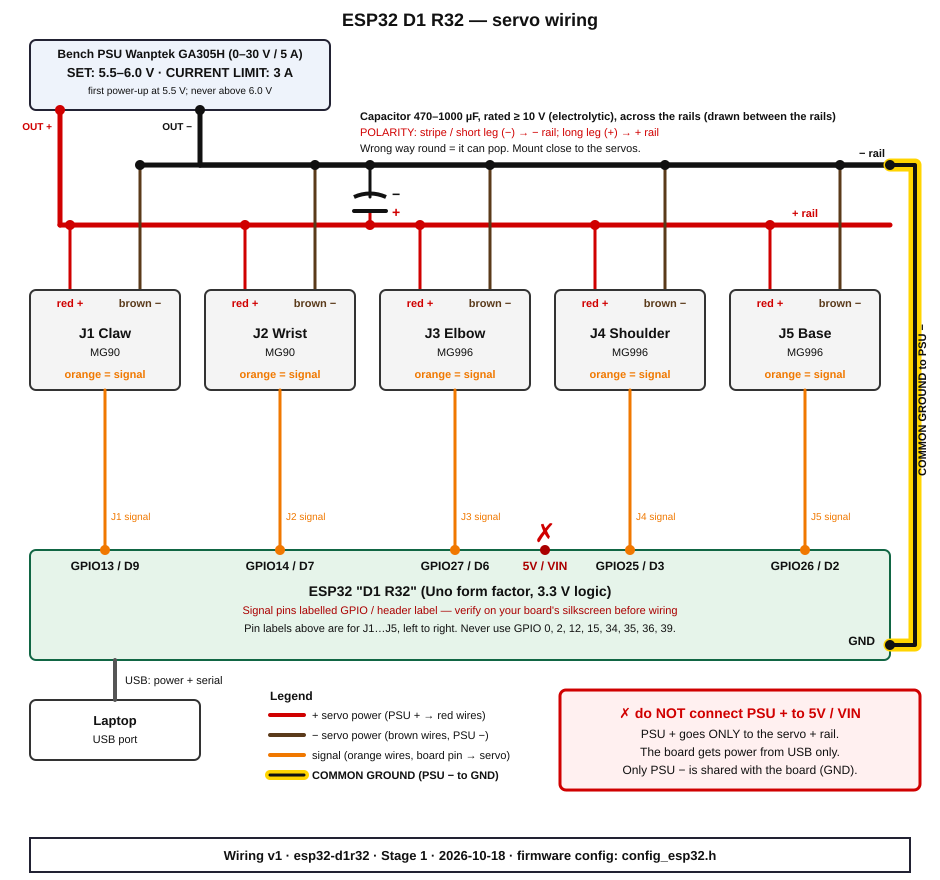
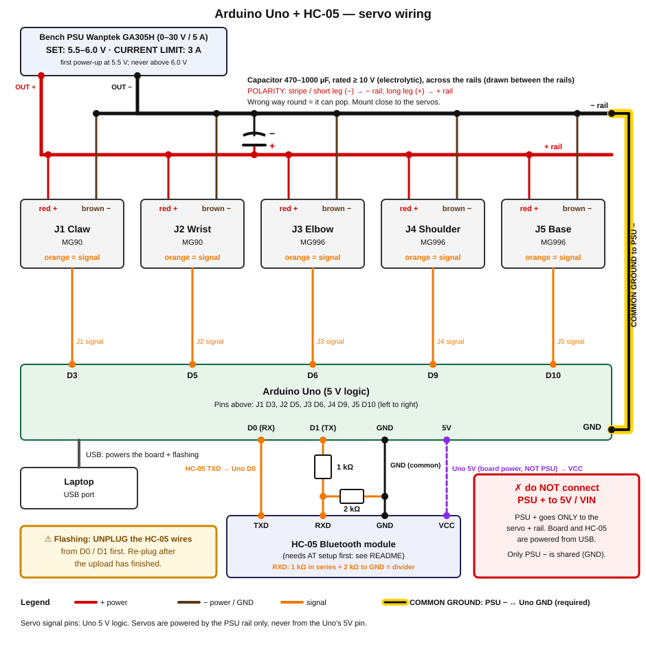

# Wiring and pre-power safety checklist

Read this whole page before connecting anything. The rule that prevents almost every burnt board:

> **The bench PSU powers the servos only. PSU + never touches the board's 5V, VIN or 3V3 pin. Only PSU − is shared with the board (GND).**

The board gets its own power from the USB cable.

## Diagrams

ESP32 "D1 R32" (recommended):



Arduino Uno + HC-05 Bluetooth module (alternative). The HC-05 must be configured first, see [HC-05 setup](#hc-05-setup-at-mode-uno-only):



Review the diagram for your board against your physical wiring before powering anything.

## Parts and limits

| Item | Value |
| --- | --- |
| Servo supply | Wanptek GA305H (0–30 V / 0–5 A). Max **6.0 V**. First tests **5.5 V**, current limit **3 A** |
| Servo wire colours | brown = −, red = +, orange = signal |
| Capacitor | 470–1000 µF electrolytic, rated at least 10 V, across the servo rail (+ to + rail, stripe/short leg − to − rail), close to the servos |
| Joints | J1 Claw (MG90), J2 Wrist (MG90), J3 Elbow (MG996), J4 Shoulder (MG996), J5 Base (MG996) |

## Pin tables

### ESP32 D1 R32

| Joint | Servo | GPIO | Header label |
| --- | --- | --- | --- |
| J1 Claw | MG90 | GPIO13 | D9 |
| J2 Wrist | MG90 | GPIO14 | D7 |
| J3 Elbow | MG996 | GPIO27 | D6 |
| J4 Shoulder | MG996 | GPIO25 | D3 |
| J5 Base | MG996 | GPIO26 | D2 |

Verify the GPIO / header-label pairing on **your board's silkscreen** before wiring. D1 R32 clones differ. If the silkscreen disagrees with this table, trust the GPIO number: the firmware uses GPIO numbers. Never use GPIO 0, 2, 12, 15, 34, 35, 36, 39 (boot-strapping or input-only pins).

### Arduino Uno

| Joint | Servo | Pin |
| --- | --- | --- |
| J1 Claw | MG90 | D3 |
| J2 Wrist | MG90 | D5 |
| J3 Elbow | MG996 | D6 |
| J4 Shoulder | MG996 | D9 |
| J5 Base | MG996 | D10 |

### HC-05 (Uno only)

| HC-05 pin | Connects to |
| --- | --- |
| TXD | Uno D0 (RX) |
| RXD | Uno D1 (TX) through **1 kΩ**; plus **2 kΩ** from HC-05 RXD to GND (divider: 5 V logic to about 3.3 V) |
| VCC | Uno 5V |
| GND | Uno GND (common) |

**Unplug the HC-05 from D0/D1 while flashing the Uno.** Also, with the HC-05 on D0/D1, commands typed over USB usually will not reach the Uno (the HC-05 TXD overpowers the USB-serial chip). For USB testing, unplug the HC-05 TXD wire from D0. The ESP32 has built-in Bluetooth and needs no extra module.

## HC-05 setup (AT mode, Uno only)

A stock HC-05 is named `HC-05` and talks at 9600 baud in data mode. The firmware expects the name `RoboArm` at 115200 baud, so configure it once:

1. **Upload BareMinimum with the HC-05 disconnected** (`File > Examples > 01.Basics > BareMinimum` in the Arduino IDE). This leaves the Uno's chip idle so the USB-serial chip can talk straight through D0/D1.
2. **Wire the HC-05 CROSSED, for AT setup ONLY.** This is different from the run-time diagram: with the chip idle, the USB-serial chip's TX drives D0 and its RX listens on D1. So: HC-05 RXD <- Uno D0 **through the 1 kΩ/2 kΩ divider** (the USB chip's TX is 5 V), HC-05 TXD -> Uno D1, VCC to Uno 5V, GND to Uno GND. Hold the button on the module (or hold the KEY/EN pin high) while powering it: the LED blinks slowly (about every 2 s) in AT mode.
3. **Send the AT commands.** Open the Serial Monitor at **38400 baud**, line ending "Both NL & CR", and send:
   ```
   AT                      (reply OK)
   AT+NAME=RoboArm
   AT+UART=115200,0,0
   AT+ROLE=0
   ```
   Each should reply `OK`.
4. **Unplug the HC-05** (power it down), then flash the RoboArm firmware: `make flash-uno PORT=/dev/ttyACM0`.
5. **Rewire per the diagram** (run-time wiring): HC-05 TXD -> Uno D0, Uno D1 -> 1 kΩ -> HC-05 RXD with 2 kΩ from RXD to GND. Power it up normally (no button/KEY). The module is now `RoboArm` at 115200 baud, and pairs with PIN 1234 (or 0000).

Module variants differ; check your HC-05's documentation if it does not answer.

## Pre-power checklist (do in this order)

Tick each item. Do not skip ahead. (Keep the PSU output off until step 9, including while you connect USB and open the monitor in step 7.)

1. [ ] **PSU output is OFF** (output switch off, board unplugged from USB, nothing powered).
2. [ ] **Set the PSU to 5.5 V and a 3 A current limit.** Never above 6.0 V. Do this with the output off and the leads disconnected; check the displayed values. Check your GA305H manual for how to view and set the current limit (some units only show or adjust it with the output shorted or via a dedicated button/knob). Do not strap PSU − to the GA305H earth/chassis terminal (it creates a ground loop with the laptop's USB ground).
3. [ ] **Wire the servo rail:** PSU + to the + rail, PSU − to the − rail. Each servo: red to + rail, brown to − rail. Leave the orange signal wires for later steps. **Check the capacitor polarity** (stripe / short leg = −, to the − rail) before it goes in. A reversed electrolytic can burst.
4. [ ] **Common ground:** one wire from the − rail (PSU −) to a board GND pin.
5. [ ] **Connect the signal wires** (orange) from each servo to the board pin in the pin table above, J1 to J5. Double-check each against the table. Power is still off; the board is still unplugged from USB.
6. [ ] **No PSU wire to the board's 5V / VIN / 3V3.** Look at every board pin with a wire on it. Only the five signal wires and the one GND wire go to the board (plus the HC-05 wires on the Uno).
7. [ ] **Board on USB only, firmware running.** Open the monitor (`make monitor PORT=/dev/ttyUSB0`); it shows `READY RoboArm` after a reset. (Over Bluetooth this line only appears if a client was already connected; send `?` to get a reply.) The servo rail is still off.
8. [ ] **Position the arm by hand near the home pose** (all joints around the middle of their range). On `H` each servo jumps at full speed to home because the firmware does not know where it currently is.
9. [ ] **PSU output ON** (USB and the monitor are already connected from step 7). Servos stay limp and do not move; nothing should twitch or heat up. If anything does, output OFF immediately and re-check steps 3 to 6.
10. [ ] **Press Home** (`H`). Joints attach one at a time: base, shoulder, elbow, wrist, claw, 300 ms apart. Keep a hand near the PSU output switch. (On the Uno an attaching servo may twitch briefly toward mid-position before moving to home.)
11. [ ] **Verify motion, then raise the limit.** Only after the arm has moved smoothly through all joints, raise the current limit toward 5 A if you need it. Keep the voltage at or below 6.0 V.

To shut down: support the arm by hand, send `R` (releases all servos), then PSU output OFF, then unplug USB. Never switch the PSU off with servos attached: the MG996 joints drop, and the board can back-feed the unpowered servo rail through its pin clamp diodes. When rewiring, remove signal wires before the ground wire.

## Troubleshooting

**PSU shows CC (hits the current limit) when you press Home or move a joint**
- Output OFF. A joint is probably stalled against a mechanical stop, a cable, or the table, or the arm was far from home and several servos jumped at once.
- Free the arm, hand-position it closer to home, and try again.
- Limits not calibrated yet? The initial range is 30° to 150°; see [calibration.md](../calibration.md).
- Do not just raise the current limit to get past this. Find the cause.

**Board resets or reboots when servos move (USB disconnects, `READY RoboArm` reprinted)**
- Servo current is dipping the supply or the ground reference. Check the capacitor is present, the right way round, and close to the servos.
- Check the common-ground wire is solid and the rail wires are thick and short.
- Lower the speed (`V 30`) and move one joint at a time.
- Confirm the PSU + really is not touching the board.

**Servo twitches or jitters at rest, or twitches when you connect**
- GPIO14 (J2) outputs PWM briefly at ESP32 boot, and opening the serial monitor resets the board. Keep the PSU output OFF whenever you plug in USB, open the monitor, or flash.
- Check the signal wire and common ground. On the Uno, keep the HC-05 wires on D0/D1 firmly seated.

**Something smells hot or a part is getting hot**
- PSU output OFF immediately, then unplug USB. Find the cause before powering again.

**No `READY RoboArm`**
- Wrong port, board still booting, or the monitor opened after boot. Press the board's reset button. See [flashing.md](../flashing.md).
